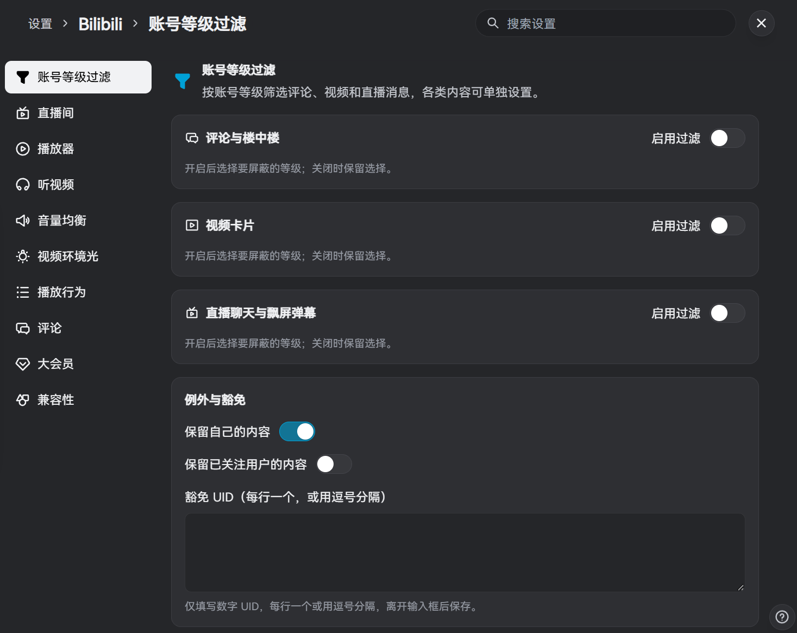

# BewlyCat Live

[BewlyCat](https://github.com/keleus/BewlyCat) 的个人 Fork，按个人使用习惯增加和调整了一些功能。部分功能实现参考了 [PiliPlus](https://github.com/bggRGjQaUbCoE/PiliPlus)。

增加了账号等级屏蔽功能，评论、视频卡片和直播消息可分别设置，支持普通 LV6 与硬核会员独立选择。另外对直播间界面和部分交互做了一些调整。

[下载安装包](https://github.com/Da-Mie/BewlyCat-Live/releases)

来源与许可见[说明](docs/credits.md)，沿用项目 [LICENSE](LICENSE)。
